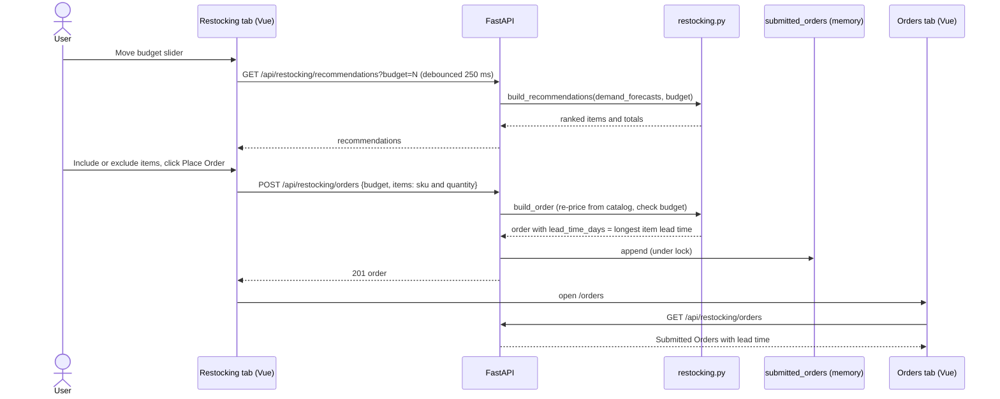

# Factory Inventory Management System

A full-stack demo application for a Claude Code workshop: inventory management, order tracking, demand forecasting, and analytics for factory operations.


## Tech Stack

- **Frontend**: Vue 3 + Vite (port 3000)
- **Backend**: Python FastAPI (port 8001)
- **Data**: In-memory mock data (no database)

## Features

- Dashboard with interactive filtering and key metrics
- Inventory tracking across multiple warehouses
- Order management with status tracking
- Demand forecasting with trend analysis
- Backlog monitoring
- Spending analytics
- Restocking planner: budget slider, priority-based recommendations from the demand forecast, and order submission with delivery lead time (see [Restocking](#restocking))
- Collapsible sidebar with an icons-only mode for smaller screens

## Quick Start

**One-command startup:**
```bash
./scripts/start.sh
# Starts both backend and frontend
# Backend: http://localhost:8001
# Frontend: http://localhost:3000
# API Docs: http://localhost:8001/docs
```

**Manual startup:**

Backend:
```bash
cd server
uv venv && uv sync
uv run python main.py
```

Frontend:
```bash
cd client
npm install
npm run dev
```

## API Endpoints

All endpoints support optional filtering via query params: `warehouse`, `category`, `status`, `month`

- `GET /api/inventory` - Inventory items
- `GET /api/orders` - Orders
- `GET /api/demand` - Demand forecasts
- `GET /api/backlog` - Backlog items
- `GET /api/dashboard/summary` - Summary statistics
- `GET /api/spending/*` - Spending data
- `GET /api/restocking/recommendations?budget=N` - Restock recommendations within a budget (`budget=0` returns `full_cost` only)
- `POST /api/restocking/orders` - Submit a restocking order (201). Prices are recomputed on the server. Returns 400 for an unknown SKU, a duplicate SKU, or a total over budget.
- `GET /api/restocking/orders` - Submitted restocking orders, newest first

## Restocking

The Restocking tab recommends demand-forecast items to buy within a budget, then submits the order. Submitted orders appear in the **Submitted Orders** section of the Orders tab, with their delivery lead time.



**How recommendations are chosen** (`server/restocking.py`):

1. Items are ranked by trend (increasing, then stable, then decreasing), then by forecast growth (highest first), then by SKU.
2. Walking that ranking, each item is funded for its full forecasted quantity if it fits the remaining budget. If it does not fit, it is skipped and the walk continues, because a cheaper item later in the list may still fit.
3. The quantity is `forecasted_demand`, because the demo data has no stock levels.
4. Money is summed in integer cents so rounding cannot push an order over budget.
5. An order's lead time is the longest lead time among its items. Expected delivery is the order date plus that lead time.

**Catalog values.** The restocking catalog lives in `RESTOCK_CATALOG` in `server/restocking.py`. Supplier names and lead times are assumptions for every SKU. Prices come from the demo data, except SNR-420 and CTL-330, which have no reference price and are also assumptions.

| SKU | Unit cost | Supplier (assumed) | Lead time in days (assumed) | Price basis |
|---|---|---|---|---|
| WDG-001 | 24.99 | Acme Components | 14 | Demo data |
| BRG-102 | 89.50 | Precision Bearings Co | 21 | Demo data |
| GSK-203 | 12.75 | SealTech Supply | 10 | Demo data |
| MTR-304 | 445.00 | Motion Dynamics | 30 | Demo data |
| FLT-405 | 8.25 | CleanFlow Industrial | 7 | Demo data |
| VLV-506 | 156.00 | FluidControl Ltd | 21 | Demo data |
| PSU-501 | 18.99 | PowerGrid Supply | 14 | Demo data |
| SNR-420 | 34.50 | SenseTech | 18 | Assumed |
| CTL-330 | 62.00 | CtrlLogic | 12 | Assumed |

**Known limitations:**
- Submitted orders live in memory. Restarting the backend clears them.
- There is no stock state, so an item that was just ordered is recommended again. The Restocking tab resets the budget after a successful order.
- Submitted orders are kept apart from `orders`, so dashboard totals, reports, and the Orders stat cards are unchanged by a submission.

## Sidebar Navigation

On screens 1024px wide or more, the sidebar starts expanded. A toggle collapses it to icons only, and your choice is remembered in the browser's `localStorage` under `sidebarCollapsed`. Below 1024px the sidebar is always icons-only and the toggle is hidden, so a saved "expanded" choice cannot squeeze the content on a phone. Hovering a collapsed icon shows its label.

## Demo Data

Mock data includes:
- Inventory items (Circuit Boards, Sensors, Actuators, Controllers)
- Orders spanning 12 months (Delivered, Shipped, Processing, Backordered)
- Demand forecasts with trends
- Backlog items
- Spending transactions

Data files: `server/data/*.json`

## Tests

```bash
cd tests
pytest backend/ -v
```

Run the tests with the server virtualenv (`server/.venv`) or any environment that has `pytest`, `httpx`, and the server dependencies installed.

## Production Build

Mock data includes:
- Inventory items (Circuit Boards, Sensors, Actuators, Controllers)
- Orders spanning 12 months (Delivered, Shipped, Processing, Backordered)
- Demand forecasts with trends
- Backlog items
- Spending transactions

Data files: `server/data/*.json`

## Production Build

```bash
cd client
npm run build  # Output: client/dist/
```

## Platform Notes

**macOS/Linux:** The one-command startup script (`./scripts/start.sh`) and stop script (`./scripts/stop.sh`) work out of the box.

**Windows:** The shell scripts in `scripts/` are macOS/Linux only. Use the manual startup commands instead. Run each in a separate terminal:

Backend:
```bash
cd server
uv venv && uv sync
uv run python main.py
```

Frontend:
```bash
cd client
npm install
npm run dev
```

To stop the servers, press Ctrl+C in each terminal window.

---

**Note:** Demo application with in-memory data. Not production-ready without database, authentication, and security implementation.
